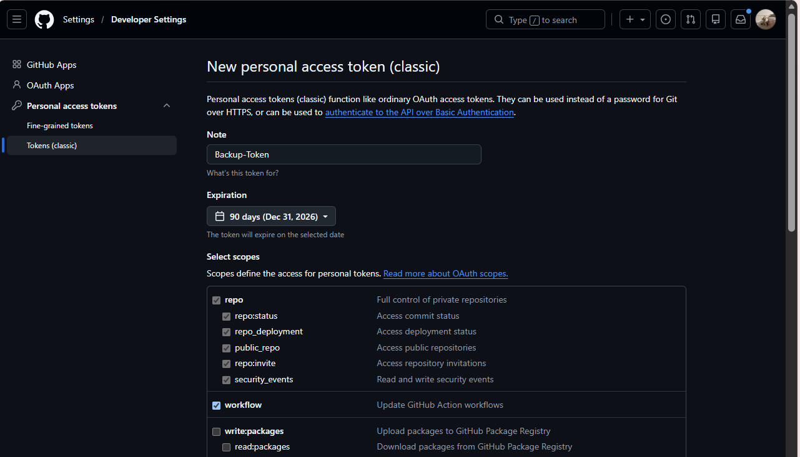
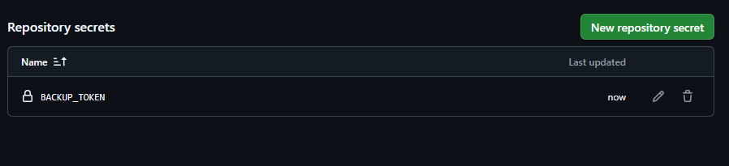
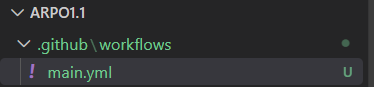
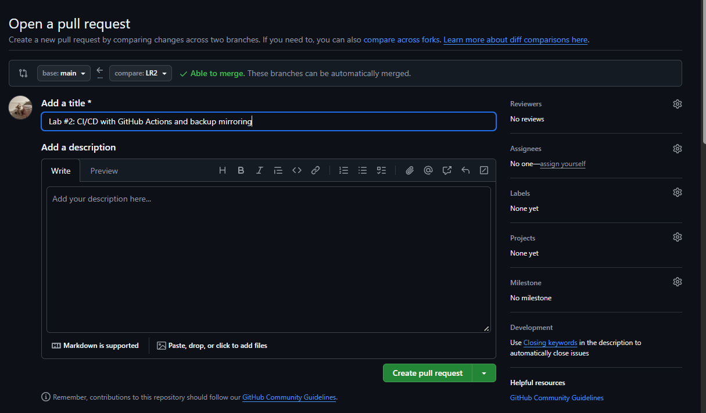
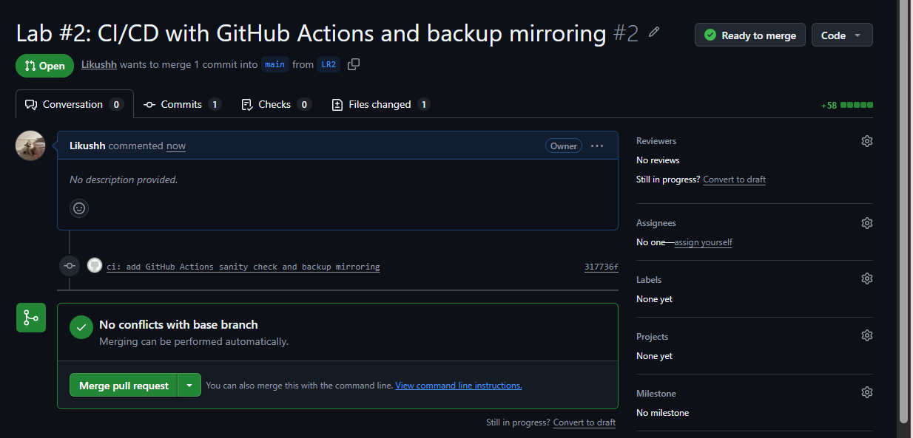
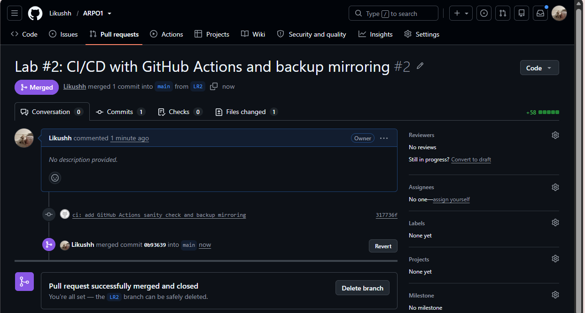
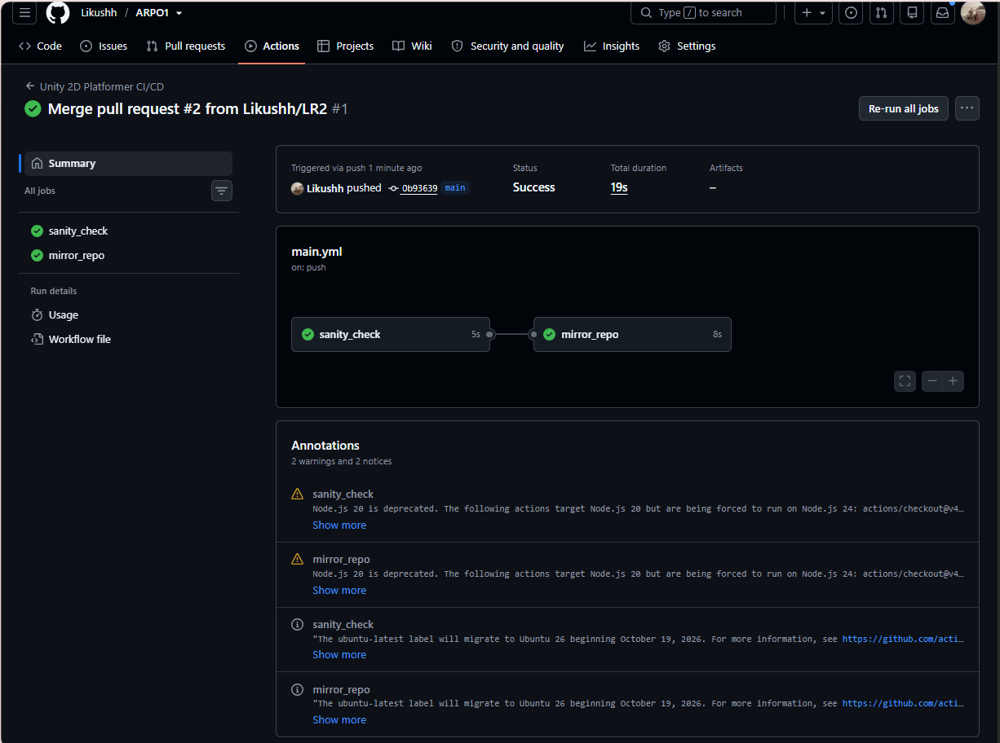
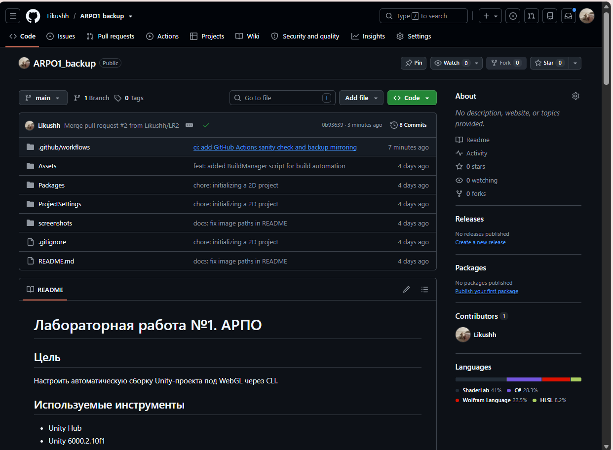

# Лабораторная работа №2. CI/CD через GitHub Actions

**Цель:** Настроить CI/CD пайплайн для автоматизации проверок и резервного копирования.

## Ход работы

### Шаг 1. Резервный репозиторий

Создан резервный репозиторий на GitHub.
![Резервный репозиторий] (screenshots/092731.png)

### Шаг 2. PAT-токен

Создан Personal Access Token (PAT) для доступа к резервному репозиторию.

### Шаг 3. Секрет BACKUP_TOKEN

В настройках основного репозитория добавлен секрет `BACKUP_TOKEN`.

### Шаг 4. YAML-пайплайн

Настроен файл `.github/workflows/main.yml`.

### Шаг 5. Pull Request

Создан и смержен Pull Request с новым пайплайном.

### Шаг 6. Запуск workflow

Workflow успешно отработал во вкладке Actions.

### Шаг 7. Зеркалирование

Код успешно зеркалирован в резервный репозиторий.

## Вывод

Настроен CI/CD пайплайн GitHub Actions: sanity check структуры проекта и автоматическое зеркалирование кода в резервный репозиторий через PAT-токен.
