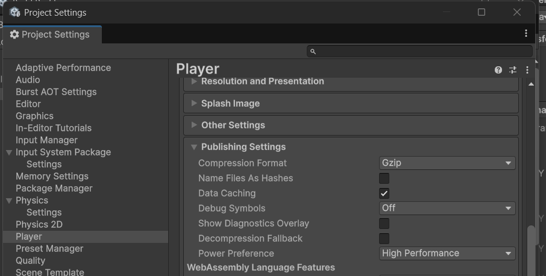
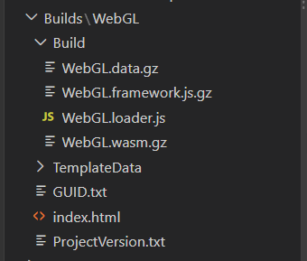
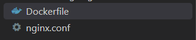
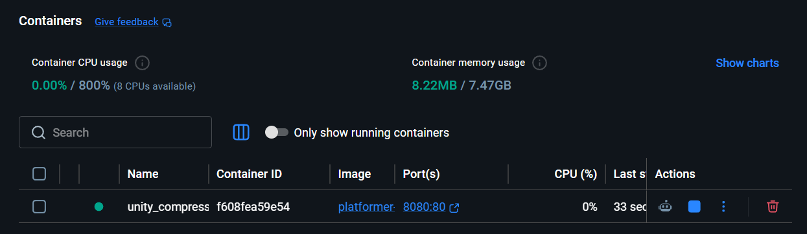
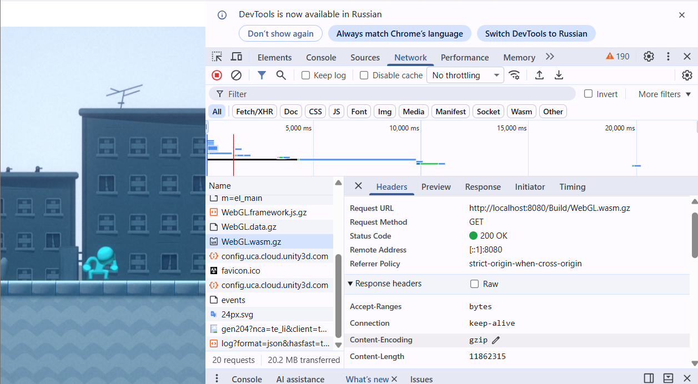
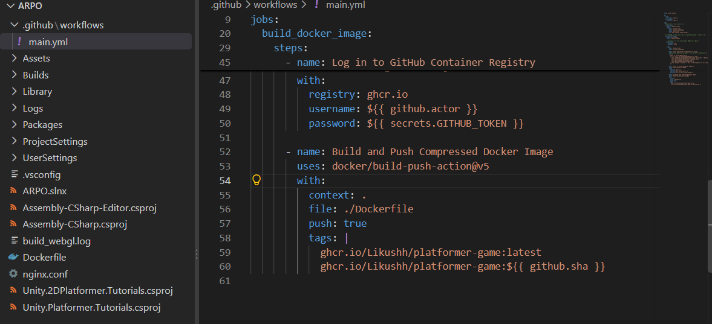
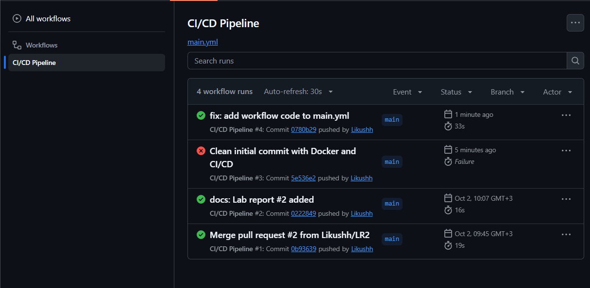
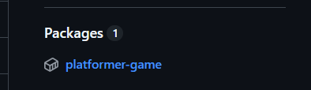

# Лабораторная работа №3. Контейнеризация веб-сервера в Docker и Nginx

**Цель:** Упаковать WebGL-сборку игры и настроенный веб-сервер Nginx в изолированный Docker-образ и настроить автоматическую публикацию в GitHub Container Registry (GHCR).

## Ход работы

### Шаг 1. Конфигурация сжатия в Unity 6 и локальная пересборка

- В настройках Publishing Settings выбран `Compression Format: Gzip`.
- Снята галочка `Decompression Fallback`.
- Проект пересобран через CLI. Проверено наличие файлов `.js.gz`, `.wasm.gz`, `.data.gz`.
  
  

### Шаг 2. Создание конфигурации веб-сервера nginx.conf

Создан файл `nginx.conf` с правилами добавления заголовка `Content-Encoding: gzip` для сжатых файлов.

### Шаг 3. Создание файла Dockerfile

Создан `Dockerfile` на базе `nginx:alpine`, который копирует настройки и файлы игры внутрь контейнера. На скриншоте созданные Dockerfile и nginx.conf.


### Шаг 4. Локальное тестирование контейнера

Выполнены команды:

```bash
docker build -t platformer-compressed:v1 .
docker run -d -p 8080:80 --name unity_compressed_container platformer-compressed:v1
```

Игра успешно запущена по адресу `http://localhost:8080`. В DevTools (вкладка Network) проверено наличие заголовка `Content-Encoding: gzip`.



### Шаг 5. Модернизация облачного пайплайна в GitHub Actions

В файл `.github/workflows/main.yml` добавлен этап `build_docker_image`. Настроена генерация фейковых `.gz` файлов, логин в GHCR и сборка/пуш образа.


### Шаг 6. Отправка изменений в облако

Изменения отправлены в репозиторий (git push).

### Шаг 7. Проверка результатов

- Все три задачи в GitHub Actions пройдены успешно (зеленые галочки).
- В профиле GitHub во вкладке Packages появился образ `platformer-game` с тегами `latest` и `github.sha`.
  
  

## Вывод

Настроена контейнеризация веб-сервера Nginx, исправлена раздача сжатых Unity 6 архивов, настроен CI/CD пайплайн для сборки и публикации Docker-образа в GHCR.
