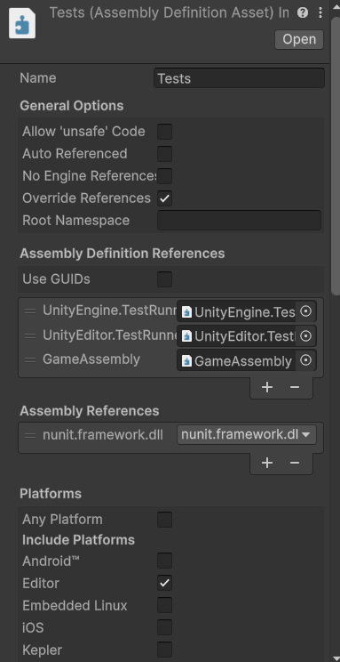
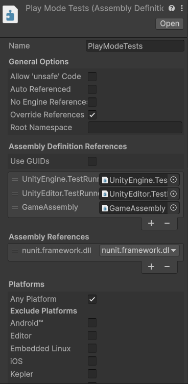
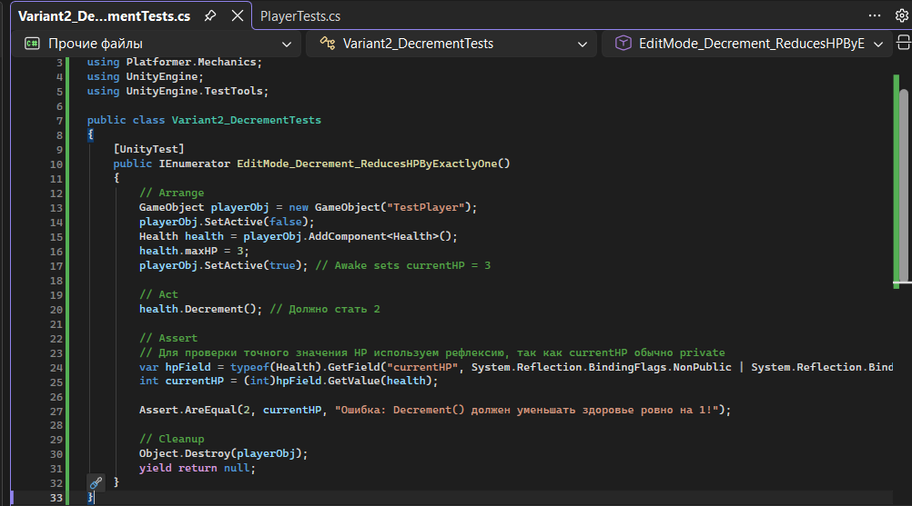
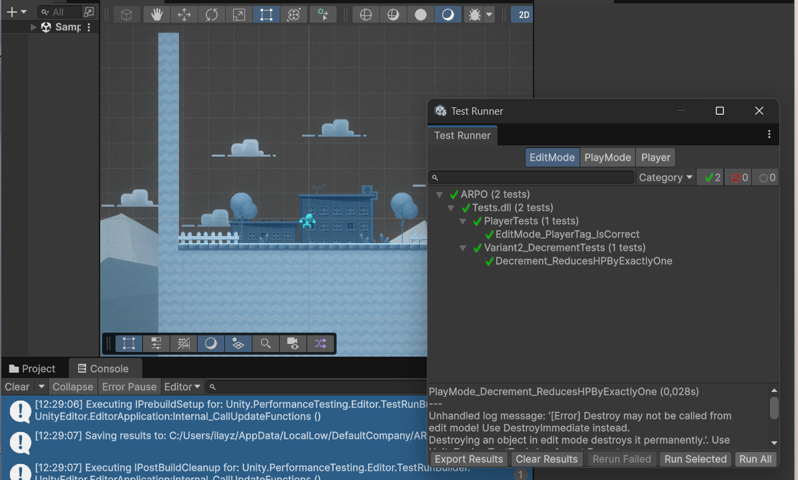
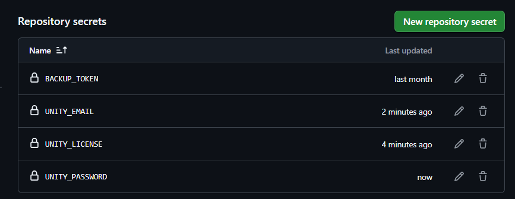
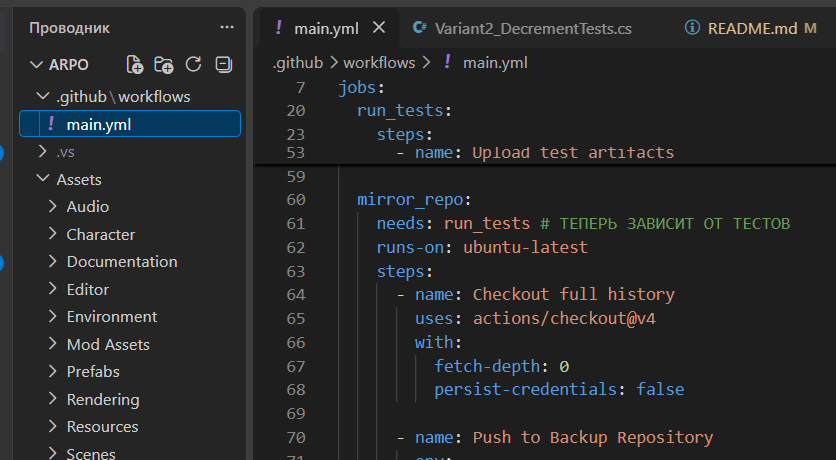
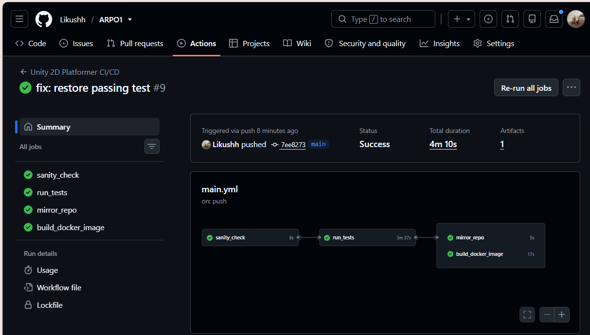
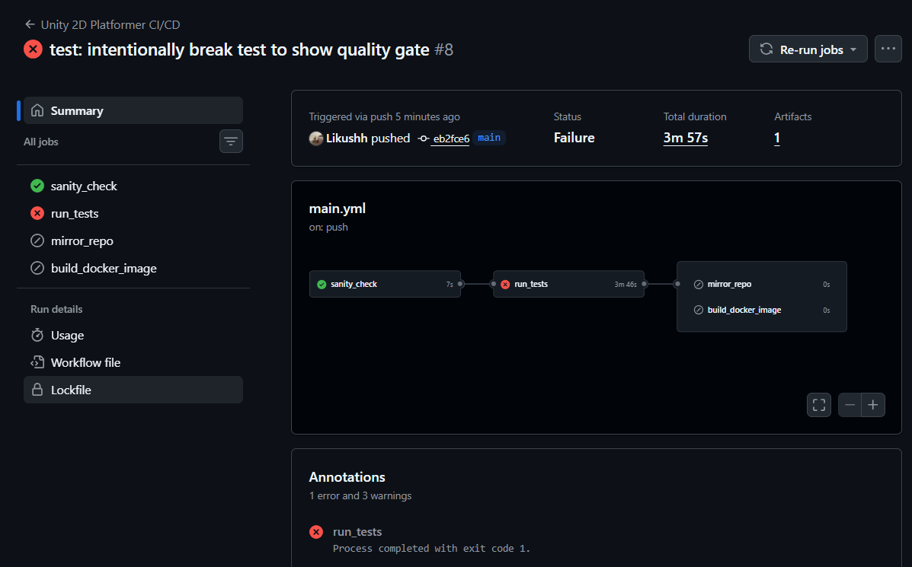

# Лабораторная работа №4. Автотесты и гейт качества в CI/CD

**Цель:** Настроить автоматическое тестирование проекта (PlayMode и EditMode) и внедрить «гейт качества» в CI/CD пайплайн, который блокирует сборку и публикацию при неудачных тестах.

## Ход работы

### Шаг 1. Разделение кода через Assembly Definitions

Для того чтобы тесты видели код игры, но не попадали в финальную сборку, были созданы Assembly Definitions:

- В папке `Assets/Scripts/` создан файл `GameAssembly.asmdef`.
- В папке `Assets/Tests/EditMode/` создан файл `Tests.asmdef` со ссылкой на `GameAssembly` и `UnityEngine.TestRunner`.
- В папке `Assets/Tests/PlayMode/` создан файл `PlayModeTests.asmdef` со ссылкой на `GameAssembly`.

### Шаг 2. Написание тестов (Вариант №2)

Были написаны тесты для проверки логики игрока:

1. **Базовый EditMode тест** (`PlayerTests.cs`): проверяет наличие тега `Player`, компонента `PlayerController` и `Health` на объекте игрока.
2. **Базовый PlayMode тест** (`PlayerHealthTests.cs`): проверяет, что после трех ударов персонаж погибает.
3. **Тест по варианту №2** (`Variant2_DecrementTests.cs`): проверяет, что метод `Decrement()` уменьшает здоровье ровно на 1. Так как поле `currentHP` является приватным, в тесте используется рефлексия для доступа к нему.

### Шаг 3. Локальный запуск тестов

Все тесты успешно пройдены в окне Test Runner (зеленые галочки).

### Шаг 4. Настройка секретов для GitHub Actions

Для работы тестов в облаке в настройках репозитория (Settings -> Secrets and variables -> Actions) были созданы секреты:

- `UNITY_LICENSE` (текст лицензии `.ulf`)
- `UNITY_EMAIL`
- `UNITY_PASSWORD`

### Шаг 5. Обновление пайплайна (Гейт качества)

В файл `.github/workflows/main.yml` добавлена задача `run_tests` (запуск тестов в Docker через GameCI). Задачи `mirror_repo` и `build_docker_image` теперь зависят от `run_tests` (`needs: run_tests`). Если тесты падают, пайплайн останавливается.

### Шаг 6. Проверка успешного пайплайна

После пуша всех изменений пайплайн прошел успешно. Все задачи (sanity_check, run_tests, mirror_repo, build_docker_image) горят зеленым.

### Шаг 7. Демонстрация работы «Гейта качества»

Для проверки работы гейта тест был специально сломан (значение `2` заменено на `1` в `Assert.AreEqual`). После пуша:

- Задача `run_tests` упала (красный крестик).
- Задачи `mirror_repo` и `build_docker_image` не запустились (статус Skipped).
- Это доказывает, что плохой код не проходит дальше тестов.

После возврата правильного значения тест снова стал проходить, и пайплайн позеленел.

## Вывод

Настроен полноценный CI/CD с автоматическим тестированием (EditMode и PlayMode). Внедрен «гейт качества», который блокирует сборку Docker-образа и зеркалирование репозитория при наличии ошибок в коде.
