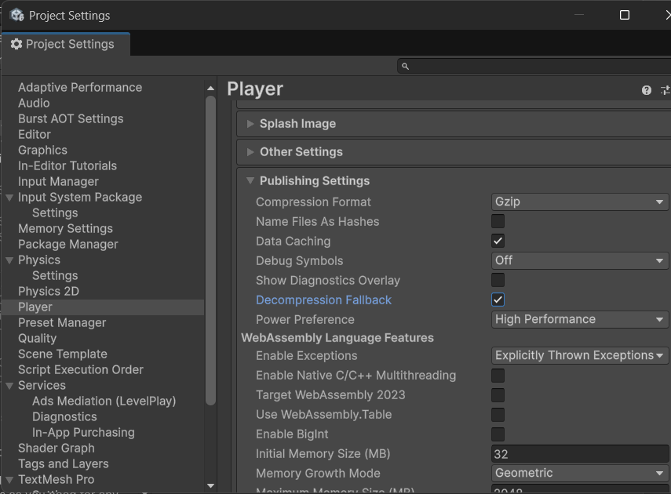
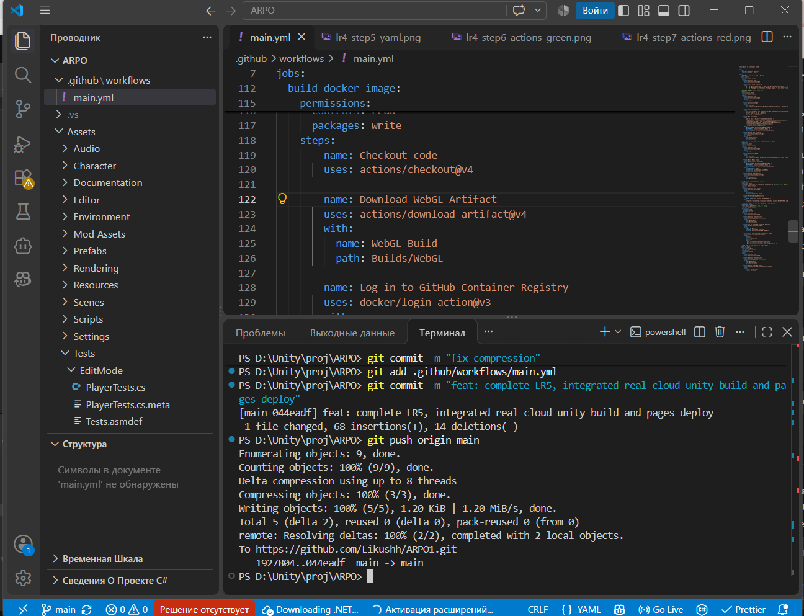
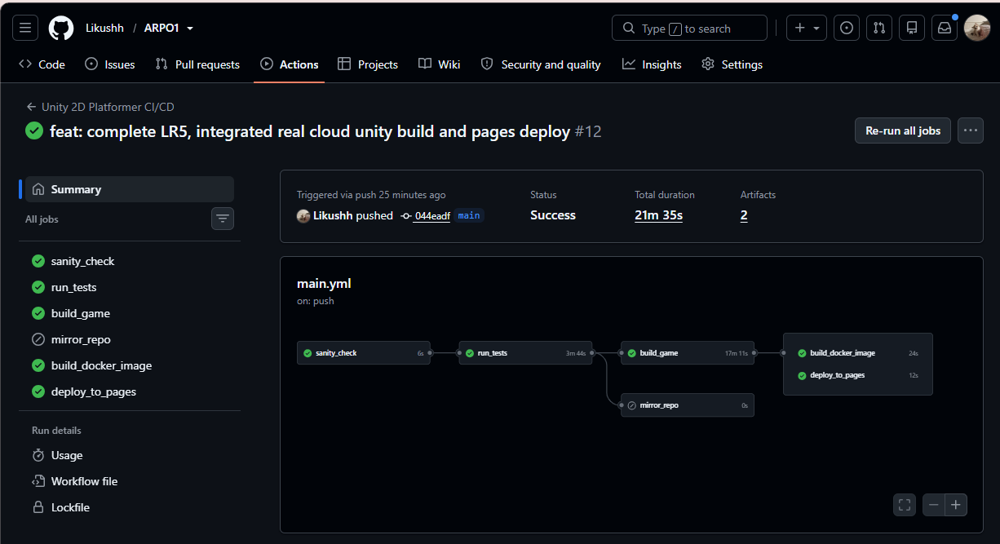
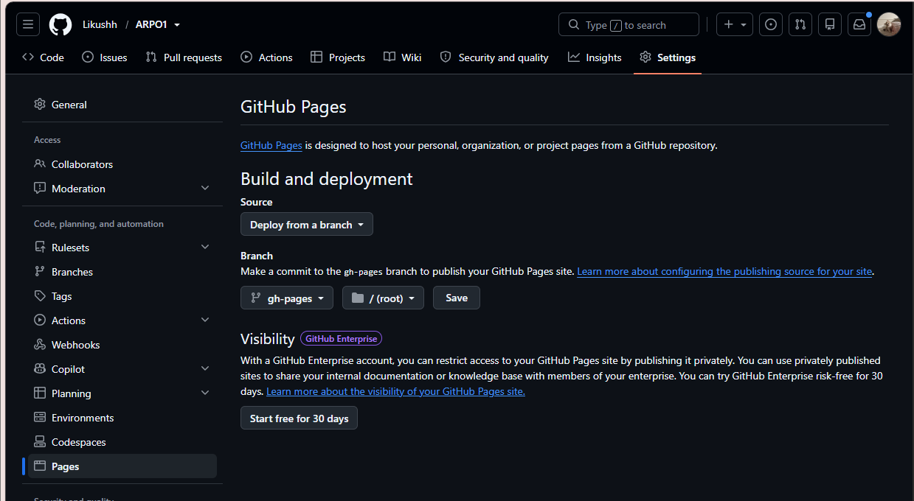
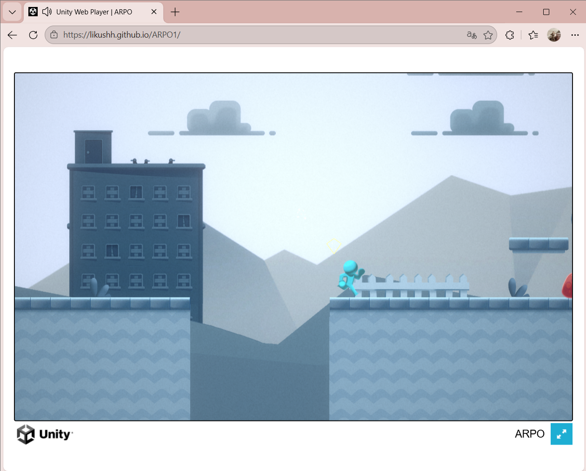
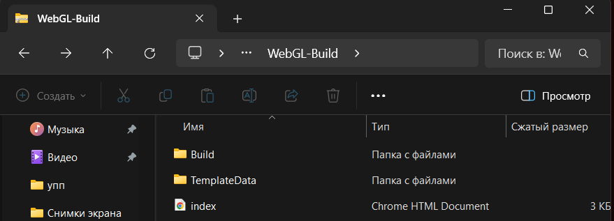
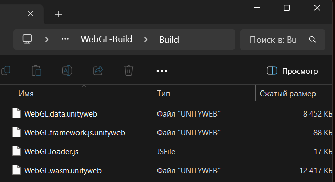

# Лабораторная работа №5. Автоматическая компиляция WebGL-игры в облаке и деплой на GitHub Pages

**Цель:** Настроить сквозной пайплайн, который после успешных тестов компилирует реальный WebGL-билд игры в облаке, публикует его на GitHub Pages и собирает Docker-образ с живой игрой вместо файлов-заглушек.

**Используемые инструменты:** Unity 6, GitHub Actions, GameCI, Docker, GitHub Pages.

## Ход работы

### Шаг 1. Подготовка Unity 6

В настройках `Publishing Settings` установлен `Compression Format: Gzip` и активирована галочка `Decompression Fallback` для корректной работы на GitHub Pages.

### Шаг 2. Модернизация пайплайна

В файл `.github/workflows/main.yml` добавлена задача `build_game` (компиляция через `game-ci/unity-builder`). Задачи `build_docker_image` и `deploy_to_pages` переделаны на скачивание артефакта `WebGL-Build`.

### Шаг 3. Запуск пайплайна

Изменения отправлены на GitHub. Первый прогон занял около 21 минуты. Все задачи (sanity_check, run_tests, build_game, build_docker_image, deploy_to_pages) завершились успешно.

### Шаг 4. Включение GitHub Pages

В настройках репозитория (`Settings -> Pages`) источник сборки переключен на ветку `gh-pages`.

### Шаг 5. Проверка результатов

1. Игра успешно загружается по ссылке `https://likushh.github.io/ARPO1/` и полностью работает.
   

2. Скачан артефакт `WebGL-Build` из задачи `build_game`. Проверено, что внутри архива находятся настоящие скомпилированные файлы игры, а не пустые заглушки.
   
   

## Вывод

Настроен полный CI/CD пайплайн. Игра автоматически тестируется, компилируется в облаке, упаковывается в Docker и публикуется на GitHub Pages.
