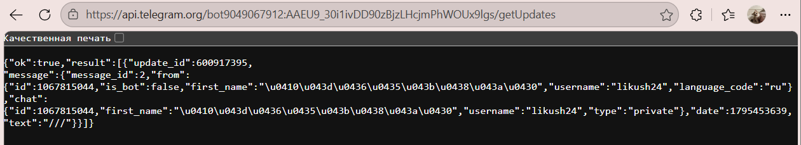
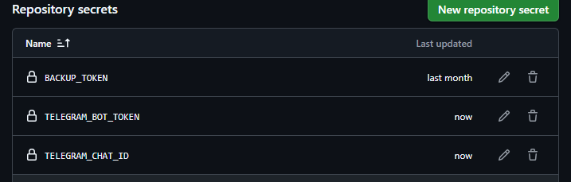
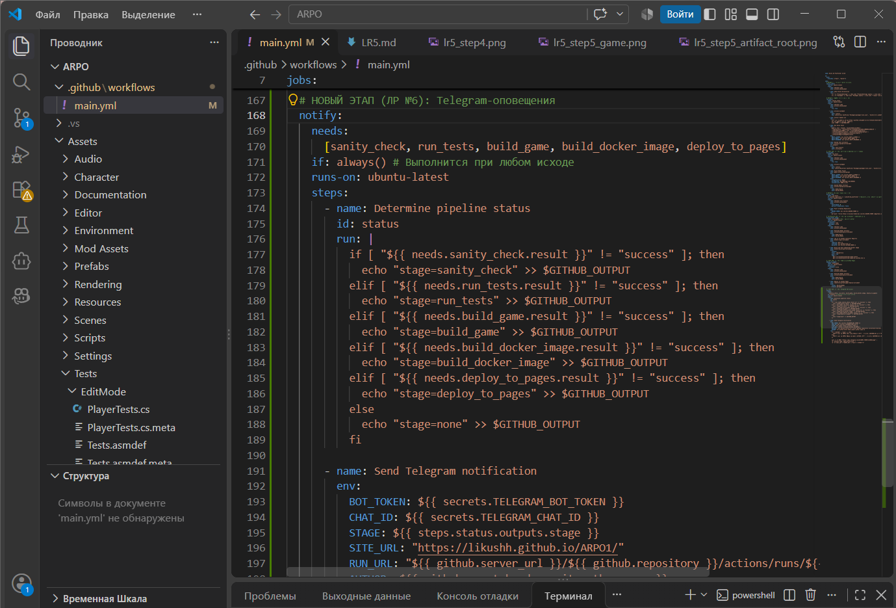
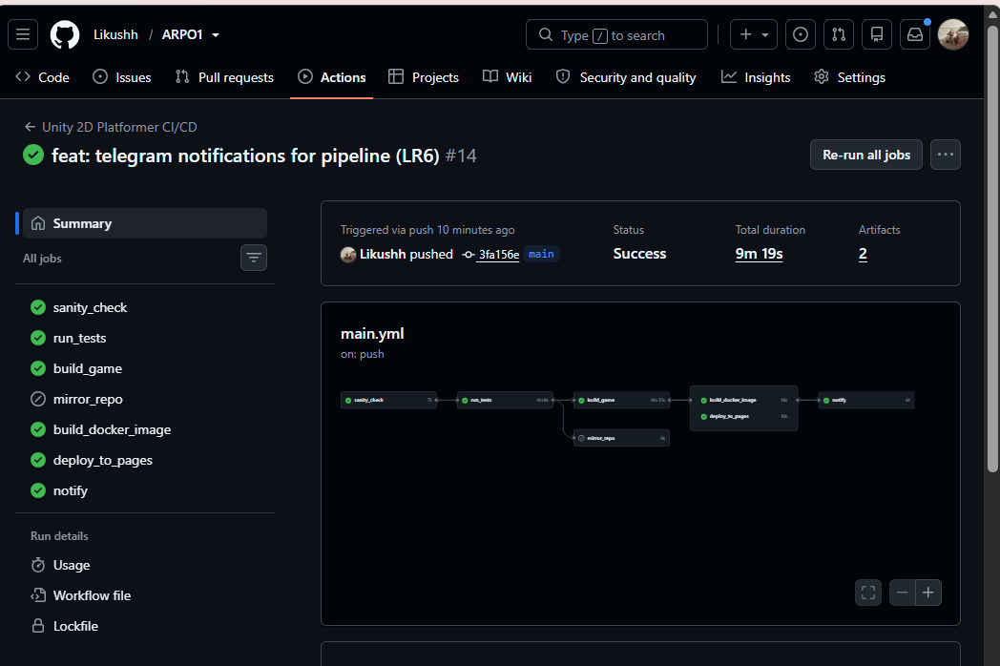
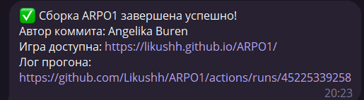
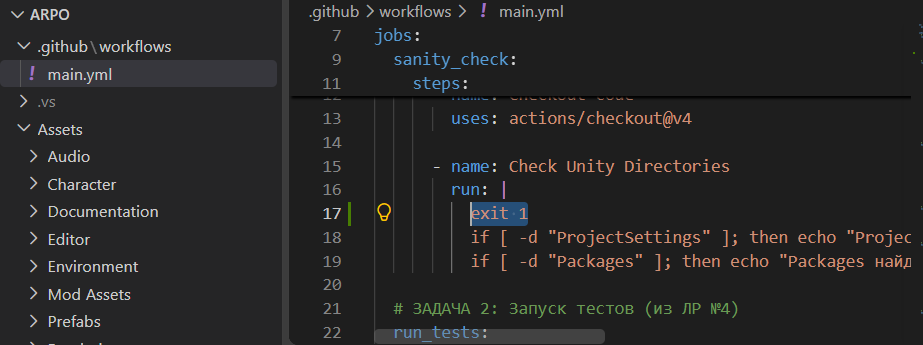
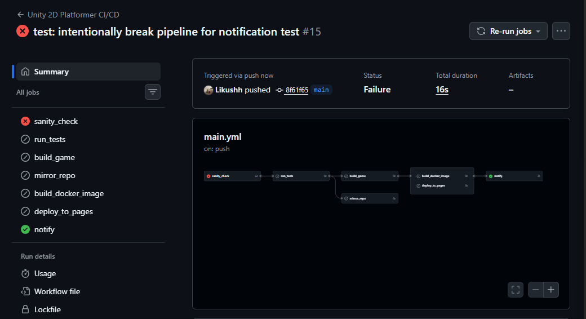
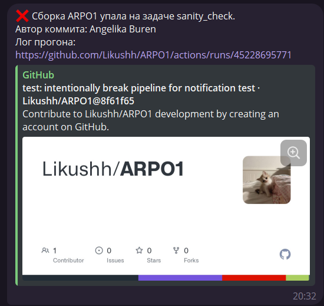

# Лабораторная работа №6. Мониторинг пайплайна, Webhooks и Telegram-оповещения

**Цель:** Настроить обратную связь от облачного сервера к команде разработки при помощи мессенджера (Telegram).

**Используемые инструменты:** Telegram Bot API, GitHub Actions (Webhooks), curl.

## Ход работы

### Шаг 1. Создание Telegram-бота и получение параметров

Через официального бота `@BotFather` был создан бот `ARPO Pipeline Bot`. Получен API-токен. С помощью метода `getUpdates` был получен `chat_id` личного чата.

### Шаг 2. Добавление секретов в репозиторий

Для безопасности токен бота и `chat_id` были добавлены в секреты репозитория GitHub (`TELEGRAM_BOT_TOKEN` и `TELEGRAM_CHAT_ID`). В файлах проекта они не хранятся.

### Шаг 3. Модернизация пайплайна

В файл `.github/workflows/main.yml` была добавлена задача `notify`. Она использует `needs` для всех предыдущих задач и условие `if: always()`, чтобы отправлять уведомление даже при падении сборки. Отправка реализована через POST-запрос `curl` к API Telegram.

### Шаг 4. Проверка успешного сценария

После отправки изменений пайплайн успешно отработал все задачи. Telegram-бот прислал сообщение с галочкой, именем автора коммита и ссылкой на игру.

### Шаг 5. Проверка аварийного сценария

Для проверки обработки ошибок в задачу `sanity_check` была временно добавлена команда `exit 1`. Пайплайн упал, но благодаря `if: always()` задача `notify` выполнилась и отправила сообщение об ошибке с указанием упавшей задачи.

После проверки код в `main.yml` был возвращен в рабочее состояние (команда `exit 1` удалена), и пайплайн снова запущен.

## Вывод

Настроен мониторинг CI/CD пайплайна с помощью Telegram-бота. Теперь команда разработки мгновенно получает уведомления об успешных сборках и ошибках, что позволяет быстрее реагировать на проблемы.
